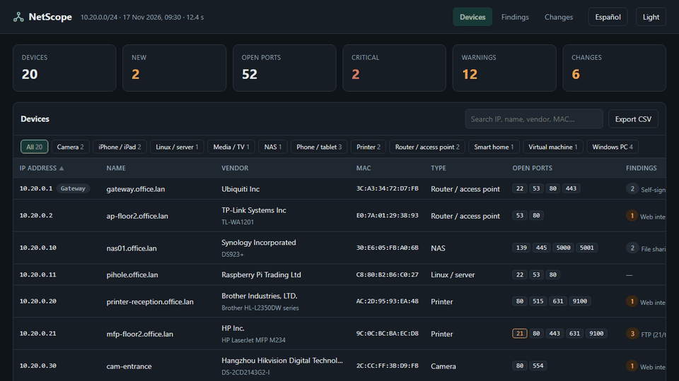

# NetScope

*Read in [English](README.md).*

**Encuentra todos los dispositivos de tu red local, averigua qué son y detecta los que suponen un riesgo, en unos diez segundos y sin permisos de administrador.**

NetScope recorre una red privada y te dice qué es cada dispositivo: *"LG webOS TV 43UJ620V"*, *"Synology DS923+"*, *"HP LaserJet MFP M234"*, *"TV del salón (Chromecast)"*. Comprueba una lista corta de puertos conocidos, busca problemas de seguridad reales y genera un panel HTML de un solo archivo. Además, recuerda los escaneos anteriores: te dice **qué ha cambiado** y te avisa por **Telegram o correo** cuando aparece un dispositivo nuevo.

### ▶ [Abrir la demo](https://davidgori.github.io/NetScope/?lang=es)



## Qué detecta

- **Dispositivos:**
  - ping y tabla ARP, que también encuentra los móviles y PC con Windows que ignoran el ping;
  - barrido TCP donde no hay tabla ARP (Android).
- **Identidad:**
  - fabricante por la MAC y DNS inverso;
  - nombres, modelos y servicios por **mDNS/Bonjour**;
  - fabricante y modelo por **UPnP**;
  - nombre y grupo de trabajo por **NetBIOS**;
  - títulos de los paneles web y cabeceras de SSH y FTP.
- **Riesgos:**
  - críticos: Telnet abierto y **SMBv1 activado**;
  - advertencias: FTP, VNC, Escritorio remoto o MQTT accesibles, paneles web solo por HTTP, **certificados HTTPS caducados** y dispositivos nuevos;
  - informativos: certificados a punto de caducar o autofirmados, y **UPnP activado** en el router.
- **Cambios:** dispositivos nuevos, los que se van o vuelven, cambios de IP o de nombre y puertos que se abren o se cierran, con historial.

Todo es **de solo lectura y no intrusivo**: nunca prueba contraseñas ni ataques, solo lee lo que los dispositivos anuncian o enseñan a cualquier cliente.

## Instalación en cualquier dispositivo

Descarga desde la [última versión](https://github.com/DavidGoRi/NetScope/releases/latest):

| Sistema | Archivo | Cómo se usa |
|---|---|---|
| **Windows** 10/11 | `netscope-windows-x64.exe` | `netscope-windows-x64.exe scan` (sin instalar Python) |
| **Linux** x64 | `netscope-linux-x64` | `chmod +x netscope-linux-x64 && ./netscope-linux-x64 scan` |
| **macOS** (Apple silicon) | `netscope-macos-arm64` | `chmod +x` y `xattr -d com.apple.quarantine` (no está notarizado), después `./netscope-macos-arm64 scan` |
| **Android** (Termux) | `netscope.pyz` | `pkg install python` y `python netscope.pyz scan` |
| **Cualquiera con Python 3.10+** | `netscope.pyz` | `python3 netscope.pyz scan` |

En Android, el sistema no deja a las apps leer la tabla ARP ni las MAC: NetScope encuentra los equipos por ping y por TCP, y el resto de la identificación funciona igual.

Si prefieres instalarlo con pip:

```bash
pip install git+https://github.com/DavidGoRi/NetScope.git
netscope update-oui   # una vez: descarga el registro de fabricantes del IEEE
netscope scan
```

## Uso

```bash
netscope scan                                  # escanea la red de este equipo
netscope watch --every 15m                     # escanea cada 15 minutos hasta Ctrl+C
netscope schedule --every 30m --alert          # tarea programada (Windows) o cron (Linux, macOS, Termux)
netscope schedule --remove
netscope alert-test                            # prueba la configuración de alertas
```

El panel se guarda en `output/netscope-report.html`, cada escaneo en `output/scans/` y los dispositivos conocidos en `output/known_devices.json`. Allí, el campo `label` le pone un nombre propio a cada dispositivo.

### Alertas

Copia [`alerts.example.json`](alerts.example.json) a `output/alerts.json` y activa Telegram o el correo. Los secretos van en variables de entorno, nunca en el archivo: `NETSCOPE_TELEGRAM_TOKEN` y `NETSCOPE_SMTP_PASSWORD`. Cada aviso se envía una sola vez; si un problema se arregla y vuelve a aparecer, se avisa de nuevo.

Las demás opciones (`--cidr`, `--ports`, `--quick`, `--json`, `--fail-on`…) están en el [README en inglés](README.md#usage).

## Uso responsable

Escanea solo redes que sean tuyas o que tengas permiso para revisar.

## Licencia

[MIT](LICENSE)
