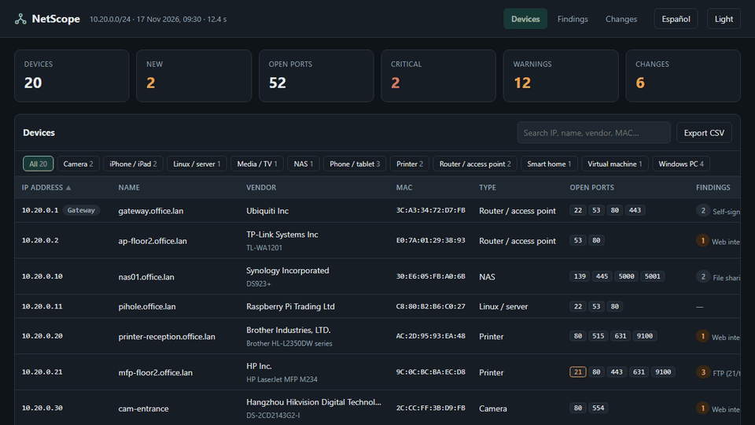
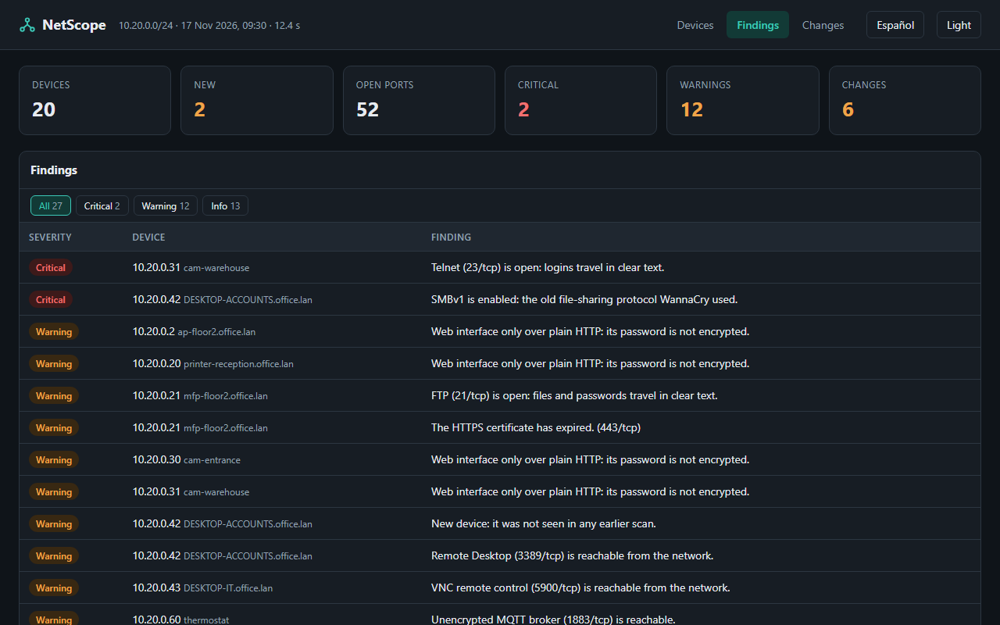
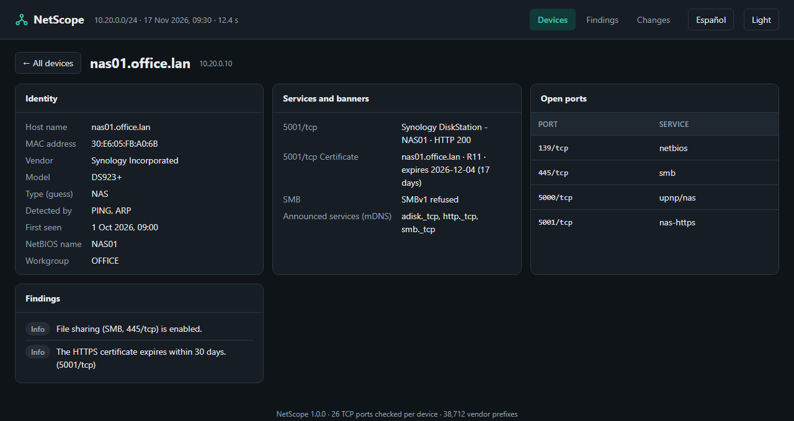
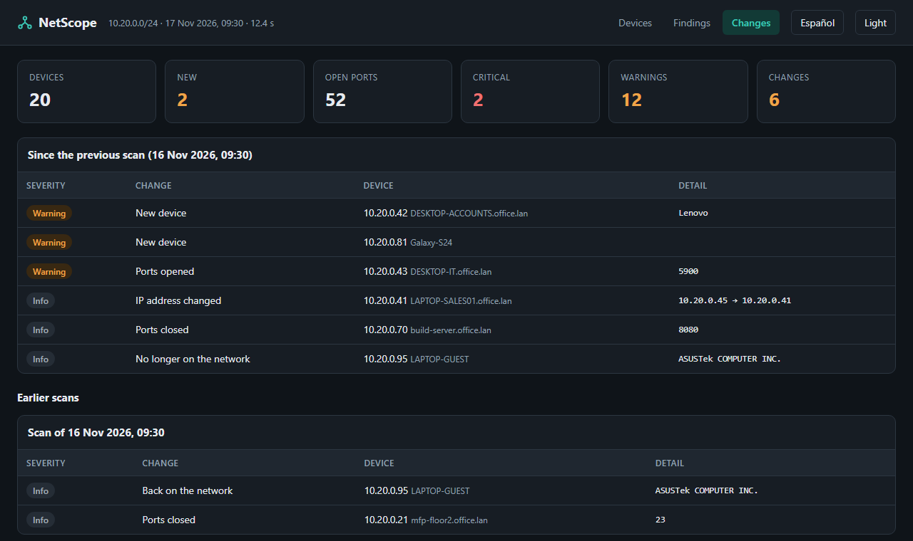

# NetScope

[](https://github.com/DavidGoRi/NetScope/actions/workflows/ci.yml)
[](https://davidgori.github.io/NetScope/)
[](https://github.com/DavidGoRi/NetScope/releases/latest)


**Find every device on your local network, find out what it is and spot the risky ones, in about ten seconds and without administrator rights.**

NetScope sweeps a private network and tells you what each device is: *"LG webOS TV 43UJ620V"*, *"Synology DS923+"*, *"HP LaserJet MFP M234"*, *"Living room TV (Chromecast)"*. It checks a short list of well-known ports, looks for real security problems and turns the result into a single HTML dashboard. It also remembers previous scans, so it can tell you **what changed** and alert you by **Telegram or email** when a new device joins the network.

### ▶ [Open the live demo](https://davidgori.github.io/NetScope/)

A fictitious office network of 20 devices, built with the same code. *Leer en [español](README.es.md).*



## What it finds

| | |
|---|---|
| **Devices** | Ping sweep + ARP table (finds the phones and Windows PCs that ignore ping), TCP probing where ARP is not available (Android) |
| **Identity** | MAC vendor (IEEE registry), reverse DNS, **mDNS/Bonjour** names, models and services, **UPnP** manufacturer/model, **NetBIOS** computer name and workgroup, web page titles, SSH and FTP banners |
| **Type** | Router, printer, camera, NAS, game console, Windows PC, iPhone/iPad, Mac, TV/media, smart home, Linux server, virtual machine, phone… |
| **Risks** | See the table below |
| **Changes** | New devices, devices that left or came back, IP and name changes, ports opened or closed, with history |

| Finding | Severity |
|---|---|
| Telnet open (credentials in clear text) | Critical |
| **SMBv1 enabled** (the protocol WannaCry spread through) | Critical |
| FTP, VNC, Remote Desktop or unencrypted MQTT reachable | Warning |
| Router, printer, camera, NAS or smart device whose admin page is HTTP only | Warning |
| **Expired HTTPS certificate** | Warning |
| New device on the network | Warning |
| HTTPS certificate expiring within 30 days, self-signed certificate | Info |
| **UPnP port forwarding enabled** on the router | Info |
| SMB file sharing enabled, private (randomized) MAC | Info |

Everything is **read-only and non-intrusive**: NetScope never tries passwords, never sends exploits and only reads what devices announce or show to any client.

## Install on any device

Download from the [latest release](https://github.com/DavidGoRi/NetScope/releases/latest):

| Platform | File | How to run |
|---|---|---|
| **Windows** 10/11 | `netscope-windows-x64.exe` | `netscope-windows-x64.exe scan` (no Python needed) |
| **Linux** x64 | `netscope-linux-x64` | `chmod +x netscope-linux-x64 && ./netscope-linux-x64 scan` |
| **macOS** (Apple silicon) | `netscope-macos-arm64` | `chmod +x netscope-macos-arm64 && xattr -d com.apple.quarantine netscope-macos-arm64 && ./netscope-macos-arm64 scan` (the binary is not notarized) |
| **Android** (Termux) | `netscope.pyz` | `pkg install python` then `python netscope.pyz scan` |
| **Anything with Python 3.10+** | `netscope.pyz` | `python3 netscope.pyz scan` (also macOS Intel, Raspberry Pi, ChromeOS Linux) |

Or install it as a command with pip (or pipx):

```bash
pip install git+https://github.com/DavidGoRi/NetScope.git
netscope update-oui   # once: downloads the public IEEE vendor registry
netscope scan
```

`SHA256SUMS.txt` in each release lets you verify the downloads.

### Platform notes

| | Windows | Linux | macOS | Android (Termux) |
|---|---|---|---|---|
| Ping + ARP discovery | ✓ | ✓ | ✓ | ping + TCP probing (Android blocks the ARP table) |
| MAC address and vendor | ✓ | ✓ | ✓ | – (not visible to apps) |
| mDNS, UPnP, NetBIOS, banners | ✓ | ✓ | ✓ | ✓ |
| Scheduled scans | Task Scheduler | cron | cron | cron (`pkg install cronie termux-services`) |

## How it works

```
 ping sweep (64 parallel) ─► ARP table ─► reverse DNS ─► TCP connect to 26 ports
                                                              │
   mDNS / DNS-SD ─┐                                           │
   SSDP + UPnP XML ┼─► identity: names, model, services ◄─────┤
   NetBIOS NBSTAT ─┘                                          │
   HTTP title, SSH/FTP banner, TLS certificate, SMBv1 ◄───────┘
                                   │
          type guess + findings ─► diff with previous scan ─► JSON + HTML + alerts
```

1. **Discovery.** Every address gets one ping. A device that ignores ping still has to answer ARP, so reading the ARP table afterwards finds it too: on a real home network, 18 devices instead of the 11 that answer ping.
2. **Ports.** An asyncio TCP connect check of 26 common ports, 200 at a time.
3. **Identification**, all in parallel and with short timeouts:
   - **mDNS/DNS-SD** queries from an ephemeral port (legacy unicast, so port 5353 does not need to be free) list services such as `_googlecast._tcp` or `_ipp._tcp`, with TXT records giving the model and friendly name.
   - **SSDP** discovery, then each device's UPnP XML description (only fetched from the device itself).
   - **NetBIOS** node status queries for the Windows/Samba name.
   - The `<title>` and `Server` header of web interfaces, the SSH/FTP greeting, the HTTPS certificate, and an SMBv1-only negotiation to see if the server accepts it.
   - Placeholder names (`none`, `Android`, hex IDs) and fake models (Samba's `MacPro7,1@ECOLOR`) are filtered out.
4. **Classification** combines ports, vendor, names, services and titles; findings come from simple, documented rules ([`classify.py`](src/netscope/classify.py)).
5. **History.** Devices are keyed by MAC in `known_devices.json`; each scan is diffed with the previous one and the result is stored with it.

On computers with several network adapters (VPN, Hyper-V, WSL), multicast queries are sent through the interface of the scanned network; otherwise the OS may pick the wrong one and no device answers.

## Usage

```
netscope scan     [--cidr 192.168.1.0/24] [--ports common|none|22,80,8000-8010] [--out DIR]
                  [--quick] [--tcp-discovery] [--no-resolve] [--no-report] [--json]
                  [--alert] [--alerts FILE] [--fail-on crit|warn|new]
netscope watch    --every 15m  [scan options]          # keep scanning until Ctrl+C
netscope schedule --every 30m | --daily 08:00 | --remove  [scan options] [--dry-run]
netscope report   output/scans/scan-20261117-093000.json [-o report.html]
netscope alert-test [--alerts output/alerts.json]
netscope update-oui
```

| Option | Meaning |
|---|---|
| `--cidr` | Network to scan. Defaults to this computer's network (a /24 if it is larger than 1,024 hosts). Only private ranges are accepted. |
| `--ports` | `common` (default), `none` for discovery only, or a custom list/range (max. 1,024 ports). |
| `--quick` | Skip identification (mDNS, UPnP, NetBIOS, banners, certificates, SMBv1). |
| `--tcp-discovery` | Also find hosts by TCP. Automatic when the ARP table cannot be read. |
| `--json` | Print the full scan as JSON. |
| `--alert` | Send the alerts configured in `OUT/alerts.json` (or `--alerts FILE`). |
| `--fail-on` | Exit with code `3` on a critical finding (`crit`), any warning (`warn`) or a new device (`new`). |

Exit codes: `0` OK, `1` error, `2` invalid arguments or target, `3` findings matched `--fail-on`.

Output goes to `output/` (or `--out`): `netscope-report.html`, `scans/scan-*.json`, `known_devices.json`. To give a device a friendly name, set its `label` in `known_devices.json`.

### Alerts (Telegram and email)

Copy [`alerts.example.json`](alerts.example.json) to `output/alerts.json` and enable a channel. Secrets go in environment variables, never in the file:

| Channel | Settings | Secret |
|---|---|---|
| Telegram | `telegram.chatId` (talk to your bot, then read the id from `https://api.telegram.org/bot<TOKEN>/getUpdates`) | `NETSCOPE_TELEGRAM_TOKEN` |
| Email | `server`, `port`, `security` (`starttls`, `ssl` or `none`), `user`, `from`, `to` | `NETSCOPE_SMTP_PASSWORD` |

`minLevel` (`crit`, `warn` or `info`) sets which findings are sent; `newDevices` and `openedRiskyPorts` turn those events on or off. Each alert is sent once: a finding that is fixed and comes back is reported again. `netscope alert-test` checks the settings.

### Automatic scans

```bash
netscope schedule --every 30m --alert        # Windows Task Scheduler or cron
netscope schedule --daily 08:00 --fail-on new
netscope schedule --remove
```

`--dry-run` shows the task or cron line without installing it. The scheduled command repeats the options you give (`--cidr`, `--quick`, `--alert`…) and uses the same executable (`.exe`, `.pyz` or Python package) you ran.

## The dashboard

One self-contained HTML file with no external resources, in **English and Spanish**, light and dark themes:

- **Devices**: summary tiles, searchable and sortable table with type filters, model, open ports (risky ones highlighted) and the most serious finding.
- **Device page**: identity (DNS, mDNS, NetBIOS and UPnP names, model, workgroup), web interfaces with titles and certificates, banners, mDNS services, open ports and findings.
- **Findings** across the network, filterable by severity.
- **Changes** since the previous scan, and the changes of earlier scans.
- CSV export, direct links (`#findings`, `#changes`, `#device=10.20.0.10`, `?lang=es`).







Names and banners come from the network and are untrusted: the scan data is escaped before it is embedded and every value is rendered as text.

## Project layout

```
src/netscope/
  network.py     interface detection (Windows, Linux, macOS, Android) and the private-range gate
  discovery.py   ping sweep, ARP table parsing, TCP discovery, reverse DNS
  ports.py       asyncio TCP connect scan
  identify.py    mDNS/DNS-SD, SSDP/UPnP, NetBIOS, HTTP/SSH/FTP banners, TLS certificates, SMBv1
  vendor.py      IEEE OUI registry download, cache and lookup; randomized MAC detection
  classify.py    device type heuristics and findings
  inventory.py   known-device register
  history.py     diff between scans
  alerts.py      Telegram and email alerts without repeats
  schedule.py    Task Scheduler / cron integration
  scanner.py     orchestration
  report.py      dashboard rendering (templates/report.html)
  cli.py         command line
tests/           pytest suite: parsers fed with crafted packets, probes against loopback servers
tools/           demo generator, .pyz and PyInstaller builds, release notes,
                 README GIF (make_gif.ps1) and social preview (social-preview.html)
```

**CI** runs ruff and the test suite on Windows and Linux with Python 3.10 and 3.13, plus a real smoke scan of the runner's own subnet. **Releases** are built by GitHub Actions on Windows, Linux and macOS when a version tag is pushed.

## Responsible use

Only scan networks you own or are authorised to audit. NetScope enforces private address ranges and a host limit, and every check is something an ordinary client does (ping, a TCP connection, an HTTP GET, a discovery query), but on a network that is not yours even that may be against the rules.

## License

[MIT](LICENSE)
